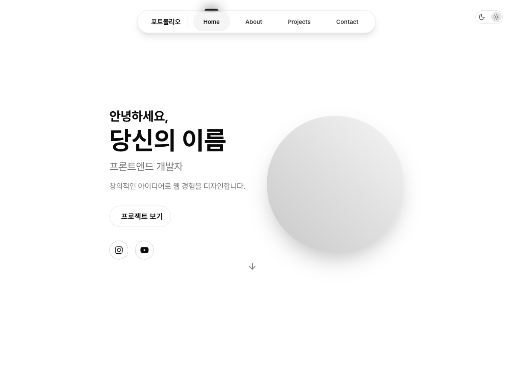

# my-site-template

코딩을 몰라도 화면에서 바로 글과 사진을 고쳐 내 포트폴리오 사이트를 만드는 Next.js 템플릿입니다.

[데모 보기](https://my-site-template.vercel.app) · [강의 영상](https://www.youtube.com/watch?v=U6zL8qittGk)

[](https://vercel.com/new/clone?repository-url=https://github.com/Mrbaeksang/my-site-template)



## 할 수 있는 것

- 내 PC에서 `Ctrl + E`로 편집 모드를 켜고 글, 사진, 영상, 배경, 메뉴를 수정
- 저장 버튼으로 변경 내용을 프로젝트 파일에 반영
- 소개, 프로젝트, 연락처 섹션과 연락처 QR 코드 제공
- 다크 모드와 모바일 화면 지원
- 링크 공유 미리보기, `robots.txt`, `sitemap.xml` 자동 생성

## 시작하기

준비물: [GitHub](https://github.com) 계정, [Vercel](https://vercel.com) 계정, [Node.js](https://nodejs.org) 20.9 이상, [Git](https://git-scm.com)

### 1. 내 저장소 만들고 배포하기

위의 **Deploy with Vercel** 버튼을 누르고 안내를 따릅니다. 내 GitHub에 저장소가 만들어지고 사이트가 배포됩니다.

### 2. 내 PC에서 내용 고치기

`내-계정`과 `내-저장소`를 실제 이름으로 바꿔 터미널에서 실행합니다.

```bash
git clone https://github.com/내-계정/내-저장소.git
cd 내-저장소
npm install
npm run dev
```

1. 브라우저에서 http://localhost:3000 을 엽니다.
2. `Ctrl + E`(Mac도 동일)를 눌러 편집 모드를 켭니다.
3. 바꿀 항목에 마우스를 올려 수정합니다.
4. 오른쪽 아래의 **저장** 버튼을 눌러 파일에 반영합니다.

업로드 제한은 이미지 5MB, 영상 20MB입니다.

### 3. 사이트에 반영하기

```bash
git add .
git commit -m "내 정보로 수정"
git push
```

push하면 Vercel이 자동으로 다시 배포합니다.

## 자주 묻는 질문

**배포된 사이트에서는 왜 편집이 안 되나요?**
편집은 내 PC의 `npm run dev`에서만 동작합니다. 방문자가 사이트를 바꿀 수 없도록 배포 환경에서는 저장 기능이 꺼져 있습니다.

**내 도메인을 연결했는데 공유 미리보기 주소가 달라요.**
Vercel 환경 변수에 `NEXT_PUBLIC_SITE_URL=https://내-도메인`을 추가하고 다시 배포하세요. 지정하지 않으면 Vercel 프로덕션 주소를 사용합니다.

**색을 바꾸고 싶어요.**
`app/globals.css`의 `@theme`과 `:root` 값을 수정하세요.

**이전에 이 템플릿을 받았어요. 업데이트해야 하나요?**
네. 이전 버전의 Next.js 15.2.4에는 보안 권고가 있고, 편집 API 보호도 추가됐습니다. 이 저장소의 변경 사항을 반영하거나 `next`를 최신 버전으로 올리세요.

**AI 도구로 고치고 싶어요.**
구조와 주의 사항을 [`AGENTS.md`](AGENTS.md)에 정리해 두었습니다.

## 기술 스택

Next.js 16, React 19, TypeScript, Tailwind CSS 4, Motion, Lucide, React Icons, next-themes, qrcode.react

## 개발

```bash
npm run lint       # ESLint
npm run typecheck  # 타입 검사
npm test           # 테스트
npm run build      # 프로덕션 빌드
```

버그와 제안은 [이슈](https://github.com/Mrbaeksang/my-site-template/issues)로 남겨 주세요.

## 라이선스

[MIT](LICENSE)

## 만든 사람

백상현 · Sanghyeon Baek ([@Mrbaeksang](https://github.com/Mrbaeksang))

- YouTube: [@Mrbaeksang95](https://www.youtube.com/@Mrbaeksang95)
- Website: [baeksang.dev](https://baeksang.dev/)
